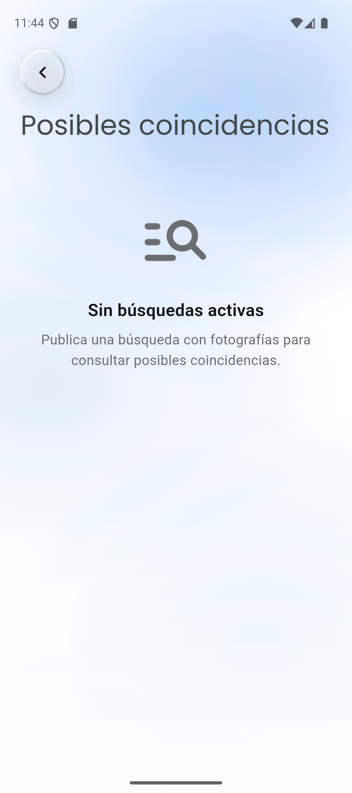
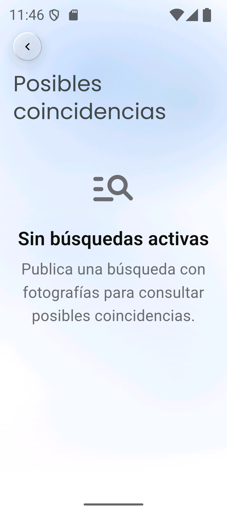
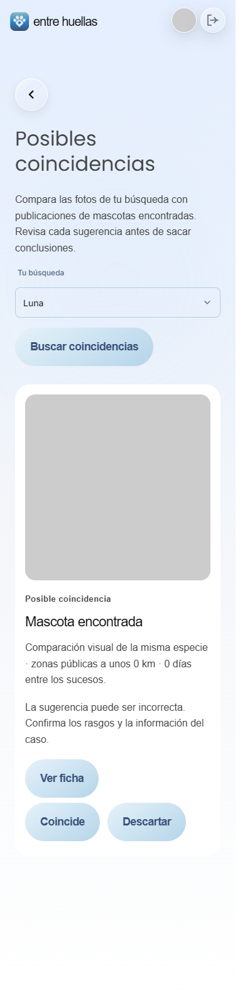
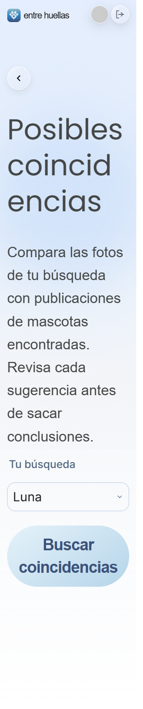
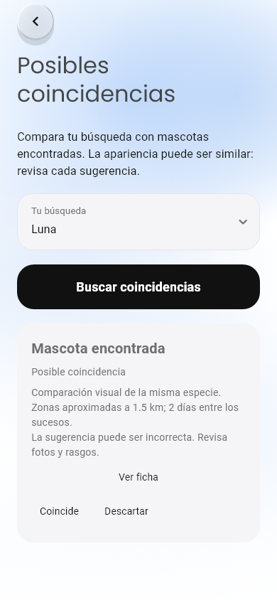
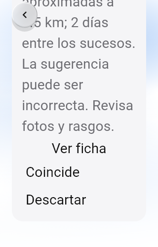

# Coincidencias: validación para cierre

**Actualización05/11:** resueltos el acceso de A y la demo alojada A/B; validación
funcional completa y pruebas web/emulador con resultados reales en el
[informe final](coincidencias-2026-11-05.md). Este documento conserva el benchmark
de calidad y la evidencia inicial; sus bloqueos de acceso/demo son históricos.

Fecha:03/11/2026, America/Lima. HU-25/#71 y HU-26/#72, RF-19/RF-20.

**Resultado: comprobaciones técnicas aprobadas y primera evaluación real ejecutada;
feature pendiente de aceptación de calidad y demo alojada completa entre cuentas.**
No se marca Done ni se cierran issues. No había un umbral numérico de calidad
previamente acordado; este informe no inventa un umbral ni una aceptación.

Código original integrado: `feature/case-matching` es ancestro de main4dab80e,
comprobado tras actualizar las referencias remotas. Correcciones de esta revisión
en `feature/case-matching-validation`, sin cambios de producto, SQL ni despliegue.

## Comprobaciones técnicas

| Comprobación | Resultado y alcance |
| --- | --- |
| Flutter completo |710/710, incluidas arquitectura, consistencia, matching, publicación, perfil y retención |
| Análisis Flutter | Completo sin incidencias; formato de las tres fixtures sin cambios |
| Web dominio/repositorios/ViewModels/arquitectura |88/88 |
| Typecheck y build Nuxt | Aprobados |
| Servidor compilado |34/34: acceso SSR, identidad web/nativa, CSRF, revisión, errores seguros y SDK nativo ausente |
| SQL/PGlite/PostGIS |68/68: instalación/repetición, permisos, índices obsoletos, revisiones, bloqueos, QR y compatibilidad042 |
| Chrome real |1440/390/320, geometría de origen/fullscreen/retorno, fotogramas, reducido, revisión/ficha, texto200% y fallo/reintento |
| CLIP real Windows |512 componentes normalizados; servidor compilado indexa dos canarios y reutiliza índices |
| Contenedor Linux de producción | Build aprobado; healthy, UID1000, sin .env/tests/fuentes de desarrollo; sharp0.35.5/libvips8.18.7 y sharp0.34.5/libvips8.17.3 funcionan |
| CLIP real Linux | Servidor del contenedor, pesos empaquetados, índice/ranking/reintento con backend de prueba; usuario node y red externa deshabilitada |
| Android nativo | APK profile x64 nuevo instalado en Pixel_9a/API36; sesión conservada, Inicio→Coincidencias→vacío confirmado→retorno; fuente de sistema200% y escalas reducidas |

Total:900 pruebas automatizadas aprobadas en esas cuatro suites; las29 focalizadas
previas se solapan y no se suman. Las imágenes canario y los repositorios de prueba
validan contratos/ejecución, no la identidad de mascotas reales.

El CI Flutter de main41095333818 fallaba en nueve pruebas por las nuevas
condiciones de retención. Se reprodujeron esos mismos nueve fallos y se corrigió
solo la preparación/liberación de las fixtures:

- `explore_filter_draft_test.dart`: inicialización del binding para sus dos pruebas.
- `pet_archiving_test.dart` y `pet_loading_test.dart`: desmontar widgets y disponer
  el contenedor antes de verificar los timers de sus siete pruebas de widgets.

RetainedQuery y el código de aplicación permanecen intactos.29 pruebas focalizadas
pasaron tras el arreglo y después las710 completas. La primera corrida local sin
`AMBIENT_BACKGROUND_MOTION=false` produjo timeouts del fondo animado y se detuvo;
la corrida aprobada usa la misma configuración que CI. No hay un nuevo CI remoto.
Las pruebas de mapas emitieron HTTP400 de teselas sin fallar: no acreditan cartografía real.

Comandos principales, desde cada directorio:

```powershell
# apps/mobile
flutter test --no-pub --dart-define=AMBIENT_BACKGROUND_MOTION=false --reporter expanded
flutter analyze --no-pub
dart format --output=none --set-exit-if-changed test/explore_filter_draft_test.dart test/pet_archiving_test.dart test/pet_loading_test.dart

# apps/platform
npm test
npm run typecheck
npm run build
npm run test:server
npm run model:smoke
node scripts/check-matching-model-server.mjs
node scripts/check-native-images.mjs
docker build --tag entrehuellas-matching-validation:local .

# database/tests
npm test
```

Para Chrome, `scripts/check-matching-browser.mjs` usa PLAYWRIGHT_MODULE apuntando
al index.mjs de playwright-core1.56.1 instalado en work/matching-validation, y
CHROME_PATH al ejecutable local. Las capturas y motion-frames.json quedan en
apps/mobile/build/ui-preview/case-matching/web. Se inspeccionaron resultados,
texto ampliado y fotogramas de apertura/cierre; sin errores JS/hidratación/CSP.

La comprobación Linux con modelo real monta solo tests y el script de smoke
en un contenedor temporal sin red; resuelve dependencias desde el servidor
empaquetado y ejecuta el diagnóstico como node. No monta configuración privada.
`check-matching-model-server.mjs` ahora respeta MATCH_MODEL_DIRECTORY para usar
los pesos de /app/models del contenedor, manteniendo la ruta local por defecto.

Logs ignorados: apps/mobile/build/matching-closure-flutter-final.log,
matching-closure-focused-fixed.log, matching-closure-analysis-final.log;
apps/platform/matching-closure-{unit,typecheck,build,server,model,real-server-final,
native,browser,docker-build,linux-model}.log; database/tests/matching-closure-sql.log.

## Evaluación por identidad con datos públicos

Fuente primaria y licencia: [Sibetan-v1, LIRMM/SEAdogSEA](https://www.lirmm.fr/YT-BB-Dog_Sibetan/),
CC BY4.0. Atribución: Eugênio Dias Ribeiro Neto et al., *Background-invariant
re-identification of dogs from camera-trap videos in non-controlled environments*,
Ecological Informatics,2025, [DOI10.1016/j.ecoinf.2025.103547](https://doi.org/10.1016/j.ecoinf.2025.103547).
El conjunto documenta59 perros y1755 imágenes de cámaras trampa de una semana de2019.

Se descargó el archivo publicado por los autores y se usaron las identidades
oficiales de gt_sibetan.json. **Las carpetas son tracklets; no se confundieron con
animales distintos.** Un script determinista separa cinco identidades de desarrollo
y54 de prueba:50 positivas con una foto de consulta/otra de galería, y cuatro
consultas cuya identidad no aparece en la galería.114 imágenes distintas por SHA256.
Selección de pares antes de observar scores: prioriza cámara y tracklet distintos.
39/50 pares cruzan tracklets; solo7/50 cruzan cámaras.

La especie es perro. Ubicación y tiempo son constantes iguales declaradas del
experimento para neutralizar esas señales; no se atribuye una fecha ni coordenada
real inventada a una captura. Se evalúa el ranking visual sobre50 candidatos,
dentro del límite de100 del piloto, con el encoder/versión actuales sin ajustes.

| Métrica | Resultado |
| --- | --- |
| Recall@5 |28/50 =56% |
| Primera sugerencia correcta |11/50 =22% |
| Primera sugerencia incorrecta entre positivas |39/50 |
| Consultas negativas con sugerencias |4/4 |
| Tiempo medio del encoder Windows CPU |48ms/foto, incluyendo carga inicial amortizada |

El ranking devuelve hasta cinco sugerencias sin umbral calibrado; que los cuatro
negativos reciban sugerencias no equivale a una probabilidad ni a una tasa binaria
de identificación. Tampoco se interpreta56% como precisión global. Este conjunto
solo contiene perros y recortes de cámaras trampa; pares de un mismo vídeo/fondo
pueden favorecer el resultado. No representa gatos, teléfonos, fotos de reportes
locales, cambios prolongados de aspecto ni latencia de Supabase/servidor alojado.
No se modificaron pesos, ranking ni interfaz para mejorar esta medición a posteriori.

[Resultado y procedencia en JSON](coincidencias-2026-11-03/sibetan-resultados.json).
SHA256 del ZIP:df974f837086ebfb25c439f8464c5102e3fb610f4e81b0f1a85a571852a7c2f9.
SHA256 del manifiesto:bb3ac92b12bb8e333b89719fcc5b050eaa3e014b73929e6d7ffd81e0cbcd0cde.
Imágenes y manifiesto de ejecución permanecen en work/ ignorado; no se subieron
a Git, Supabase ni servicios de inferencia. Se conserva atribución/licencia en
el manifiesto y resultado. Esta evaluación no entrena ni modifica el modelo.

Para reproducir, descargar/extraer el ZIP enlazado en la fuente oficial y comprobar
su hash; desde apps/platform, con pesos locales preparados:

```powershell
node scripts/prepare-sibetan-evaluation.mjs ../../work/matching-evaluation/sibetan/Sibetan
$env:MATCH_MODEL_DIRECTORY=(Resolve-Path '.cache/matching/clip-vit-b32-d15189d-q8-v1').Path
npm run model:evaluate -- ../../work/matching-evaluation/sibetan/Sibetan/evaluation-manifest.json
```

## Servidor alojado y cuentas

Preflight real contra https://entrehuellas.app:

- /health200; /coincidencias sin sesión redirige302.
- API nativa sin autorización403; token inválido401.
- B: renovación de sesión válida y lista de búsquedas200, vacía confirmada.
- A: Auth400 con código invalid_credentials, aunque hay una contraseña configurada.

El diagnóstico no cambia contraseñas, permisos ni perfiles. B no necesita conocer
su contraseña porque hay un refresh token vigente; su rotación se conserva en la
misma configuración privada ignorada. No se registran tokens/correos/contraseñas.

```powershell
# apps/platform; sale con código1 mientras no pasen todas las comprobaciones.
node scripts/check-matching-hosted.mjs
```

Este script solo comprueba disponibilidad/autorización/listado. No publica,
compara ni revisa casos; una lista vacía no acredita el flujo completo. Se respeta
la confirmación previa del usuario de patch040 aplicado, sin reaplicarlo. No hay
escrituras de producto ni despliegues remotos en esta revisión.

## Android y capturas

El usuario eligió usar el emulador disponible. Compilación profile x64 de69.5MB e
instalación por actualización, sin desinstalar ni borrar datos. SHA256 APK:
16cd84fe864ae81441b63387ac807df50a00491c3e098343e91b02437ca69689.
Ruta local: apps/mobile/build/app/outputs/flutter-apk/app-profile.apk.

Se aplicó solo al proceso el workaround de Java documentado en CONFIGURACION
para el fallo inicial de loopback; no se cambió Gradle global. El build avisó
de la fuente CupertinoIcons sin empaquetar, sin impedir compilar; no se afirma
una auditoría de iconos de toda la app. Los ajustes del emulador de fuente y
animación se restauraron. No se publicaron casos desde la sesión conservada.













Las capturas de resultados web/Flutter usan fixtures; las dos de Android son del
servidor real con la sesión conservada y sin búsquedas activas. No se presenta un
resultado simulado como una comparación real del emulador.

## Qué falta para cerrar

1. Resolver el acceso de A y demostrar publicación, comparación, revisión/reintento
   y retirada/cierre con dos cuentas en el entorno alojado acordado. No se publican
   falsos reportes en una comunidad real para fabricar esa evidencia.
2. Revisar/mejorar y aceptar explícitamente la calidad observada, con estos límites
   visibles. La ejecución de900 pruebas no sustituye la calidad del ranking.
3. Integrar las correcciones de fixtures y comprobar el nuevo CI. En esta tarea
   no se hizo commit/push ni se modificaron GitHub/Projects.

No se acredita teléfono físico, que quedó fuera de la comprobación solicitada
al elegir el emulador. Tampoco hay precisión garantizada ni avisos automáticos.
