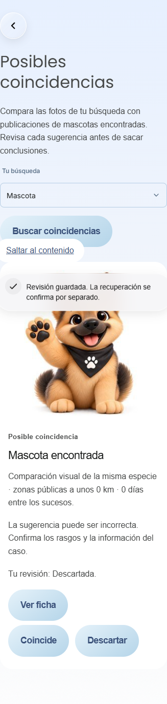
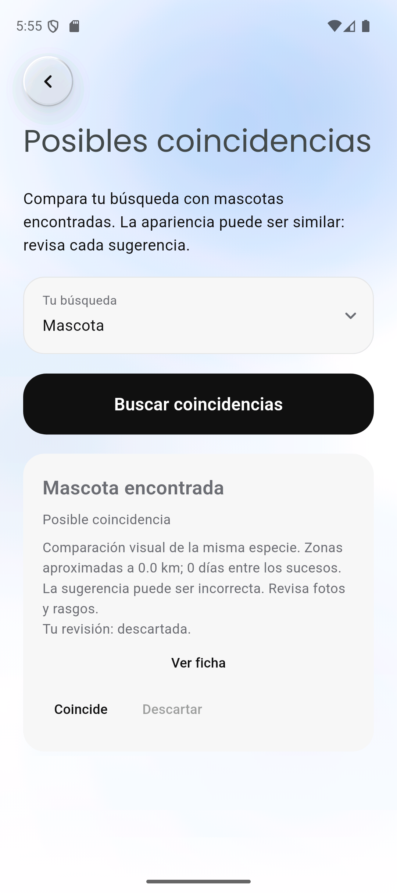
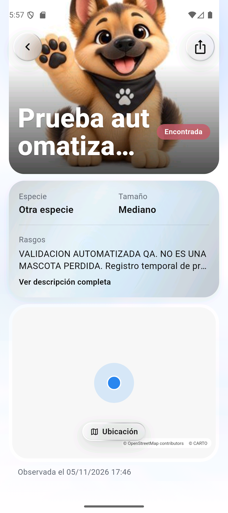

# Coincidencias: validación funcional finalizada

Fecha:05/11/2026, America/Lima. HU-25/#71, HU-26/#72; RF-19/RF-20.

**Se completó la validación que faltaba con dos cuentas y servidor reales.**
El acceso de A ya funciona. La publicación/procesado de fotos, comparación CLIP,
revisión, ficha, reintento, privacidad, cierre y retirada se ejecutaron contra
https://entrehuellas.app y el Supabase configurado, además del navegador y Android.
No se cambiaron contraseñas, perfiles, permisos, SQL, modelo ni código de producto.

## Resultados

| Comprobación | Evidencia |
| --- | --- |
| Preflight final |7/7, ambas cuentas autenticadas, listas200 vacías tras limpiar; anónimo/token inválido rechazados |
| Flujo alojado |12/12: Auth, dominio/repositorios reales, Edge Function, Storage, RPC/RLS y Nuxt/CLIP |
| Navegador alojado |5/5 grupos: foto, búsqueda, revisión, ficha/retorno,320/texto200%/reducido, fallo de red/reintento; sin errores JS |
| Android API36 | Sesión QA por callback real, Inicio→Coincidencias, resultado real de B, revisión confirmada/toast, ficha/retorno y fuente200%/escalas reducidas |
| Regresiones previas del mismo código de producto |710 Flutter,88 web,34 servidor compilado y68 SQL/PostGIS:900 aprobadas el03/11 |
| Calidad medida | Sibetan:28/50 consultas con pareja correcta en top5 (56%),11/50 en top1 (22%); no se modificó ni repitió el modelo para cambiar ese resultado |

Resultados estructurados: [flujo alojado](coincidencias-2026-11-05/flujo-alojado.json),
[navegador](coincidencias-2026-11-05/navegador.json), [emulador](coincidencias-2026-11-05/emulador.json).
Benchmark y metodología: [evaluación03/11](coincidencias-2026-11-03.md).
Los resultados de CI de las correcciones se registran en la PR de validación;
este informe distingue esa comprobación de las pruebas alojadas.

## Cuentas y recorrido real

A existía y estaba confirmada, aunque su contraseña guardada era rechazada.
Se usó la API administrativa Auth solo para buscar esa cuenta exacta, generar
una capacidad magiclink y verificarla. **No se envió correo ni se cambió la
contraseña**, no se crearon usuarios ni se otorgaron permisos. La sesión obtenida
y B se usan después con tokens normales verificados por los endpoints del producto.
Los refresh tokens rotados se guardan únicamente en config local ignorada.
Esta preparación de QA no se incorpora como acceso alternativo a la aplicación.

Se publicaron una búsqueda comunitaria por A y un hallazgo independiente por B,
con UUID nuevos, textos explícitos «VALIDACION AUTOMATIZADA QA. NO ES UNA MASCOTA
PERDIDA» y una ilustración propia de onboarding convertida a dos JPEG distintos.
La coordenada0/0 pertenece al ensayo, no a un avistamiento real. Antes de publicar
se comprobó que no hubiera zonas de interés dentro de un rectángulo que contiene
el radio máximo50km. No se siguieron los casos desde otras cuentas.

Las operaciones usan PublishRecoveryReport→ServerRecoveryRepository→RecoverySource,
el procesador de fotos desplegado y las RPC reales. El servidor alojado indexa
dos vectores512D normalizados y los conserva para el reintento. Solo A puede
comparar su búsqueda. B no puede revisar en nombre de A; una revisión de una
versión obsoleta devuelve409. Confirmar y descartar persisten; ignorar el primer
ACK y repetir su UUID no duplica ni revierte una decisión posterior. Confirmar
no cierra la búsqueda ni asigna mascota/propietario.

Al retirar el hallazgo de B desaparece de los candidatos. Al cerrar la búsqueda
de A deja de aparecer en la lista y una comparación nueva devuelve403. Finalmente
se retiran los reportes QA y se eliminan sus renditions/thumbnails de Storage.
La primera ejecución con UI y la repetición final crearon cuatro reportes QA en
total; todos quedaron retirados y sus ocho objetos de fotos/miniaturas se eliminaron.
Recibos de revisión/cierre e historial de esos ensayos se conservan según dominio.
No se alteró un caso preexistente ni se vaciaron tablas/buckets.

El harness inicialmente intentó comprobar notificaciones con SELECT directo de
service_role. El403 era la prohibición de grants esperada, no un fallo del producto.
Se corrigió la expectativa y se repitió el flujo completo12/12, manteniendo esa
prohibición. No se habilitó acceso a bandejas privadas ajenas. La ausencia de
destinatarios de publicación se comprueba antes mediante zonas y contrato de fanout;
no se presenta como una lectura de notificaciones privadas de todos los usuarios.

## Navegador y emulador

El navegador usa la sesión QA Auth válida con el serializador existente de cookie
HttpOnly. El servidor vuelve a verificar identidad y perfil. Se prueba la UI de
Coincidencias alojada; no se afirma haber repetido la entrada por contraseña/OTP.
Se confirmó que la foto autorizada se decodifica, se guardan Coincide/Descartar,
se abre la ficha real con texto QA y se regresa a Coincidencias. Una interrupción
de red de la petición de comparación muestra el error y permite reintentar.
El harness admite que otra UI haya confirmado antes, sin intentar pulsar un botón
correctamente deshabilitado por una revisión ya persistida.



En Android se usó el APK profile x64 del03/11 sobre Pixel_9a/API36, cuyo código
de producto coincide con esta revisión. La sesión QA entra mediante el callback
nativo existente; la pantalla obtiene el candidato de B desde el servidor real.
Pulsar Coincide guarda la revisión, actualiza «Tu revisión: coincide» y muestra
el toast confirmado. Ver ficha abre el reporte público real y se vuelve al mismo
recorrido. Fuente del sistema200% y escalas reducidas comprobadas/restauradas.
Se usó el emulador según instrucción del usuario; no se afirma prueba física.





Otras capturas: [web320/texto200%](coincidencias-2026-11-05/web-320-texto-200.png),
[Android/texto200%](coincidencias-2026-11-05/android-texto-200.png).
Las capturas web excluyen la cabecera con avatar privado. La ficha Android no
acredita disponibilidad/estilo de teselas remotas; esa cartografía queda fuera
de la validación de Coincidencias.

## Reproducción

Desde apps/platform, con configuración QA local ignorada, sesiones vigentes y
la configuración de servidor solo en .env.local:

```powershell
node scripts/check-matching-hosted.mjs
node --experimental-transform-types scripts/check-matching-hosted-flow.mjs --run-qa
```

El primer comando solo lee. El segundo exige --run-qa porque crea datos de ensayo;
retira solo sus UUID y limpia fotos propias en finally. --hold-for-ui permite la
comprobación manual nativa mientras los casos están activos, con vencimiento
de diez minutos y limpieza al salir. Durante esa pausa puede ejecutarse:

```powershell
node --experimental-transform-types scripts/check-matching-hosted-browser.mjs
```

El diagnóstico de navegador requiere playwright-core1.56.1 instalado en
work/matching-validation y Chrome local. Las capacidades efímeras de UI se guardan
en work/ ignorado; no deben incluirse en Git ni en evidencias compartidas.
Ejecutar el script sin --run-qa no publica registros.

Logs locales: apps/platform/matching-validation-2026-11-05-{preflight-final,
flow-final,browser-final}.log. La evidencia JSON versionada no contiene sesiones,
tokens, correos, contraseñas, vectores ni rutas Storage privadas.

## Cierre de validación y límites de producto

Las comprobaciones funcionales, evaluación reproducible, demo alojada y recorrido
nativo solicitados están terminados. El56% del benchmark es un resultado conocido
y limitado a esa muestra, no una probabilidad de identidad ni una garantía global.
No había un umbral numérico de aceptación pactado; no se inventó uno al terminar.
La decisión de aceptar esa calidad o mejorar el motor pertenece al producto y
no se sustituye por repetir pruebas técnicas. No se cierran issues ni se fusiona
o despliega la aplicación automáticamente por terminar esta validación.
